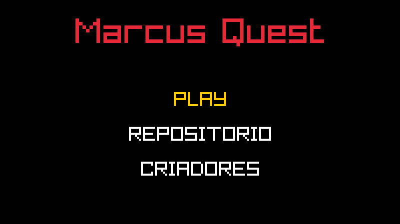
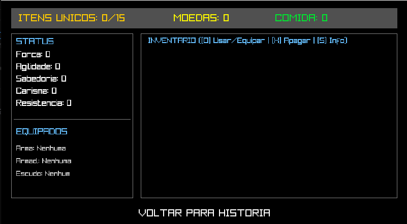
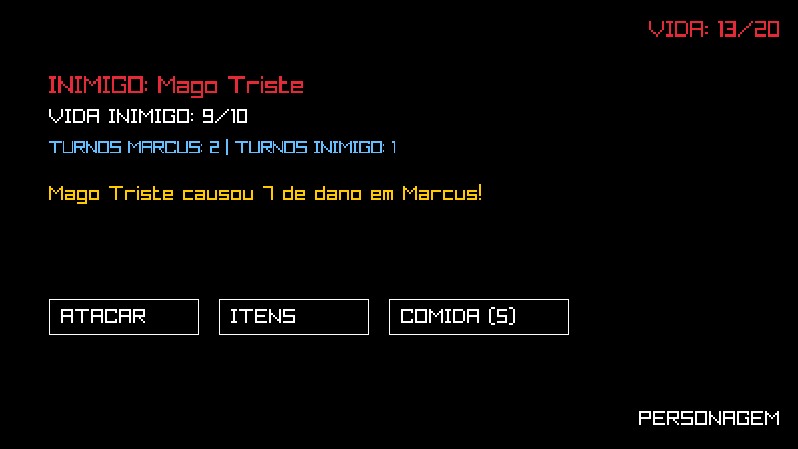
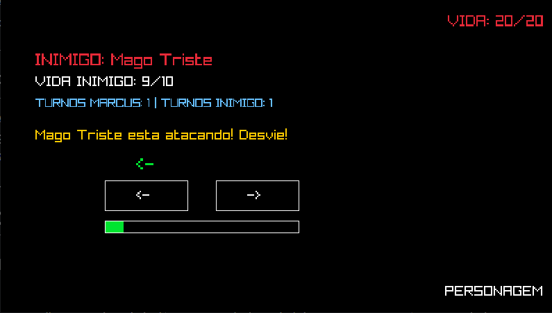

# Marcus Quest

RPG narrativo em **linguagem C** desenvolvido com **Raylib**, focado em escolhas com ramificações, gestão de personagem e inventário, e combate por turnos com *Quick Time Events* (QTE).

<div align="center">
  
</div>

---

## Sinopse

Você acompanha **Marcus Professus**, um DEV (*Defensor Extremamente Versátil*) que vive tranquilamente em **Code Valley** ao lado de seu companheiro e elefante mágico, **Philip Honorarius Professus** (também referido no esboço narrativo como **PHP**). Quando os temidos **PYTHON** sequestram o elefante, Marcus parte em uma jornada por cenários como a taverna e a vila para resgatá-lo.

Ao longo do prólogo e do primeiro capítulo, suas decisões moldam o caminho da história, permitem escolher a classe inicial (**Mago**, **Guerreiro** ou **Arqueiro**) com equipamentos próprios, comida e moedas, e conduzem a confrontos contra adversários como o *Mago Triste*.

---

## Proposta de Tela (Estilo Portátil / Game Boy)

A janela do jogo foi pensada com proporção compacta (`800x450`) para **simular a proposta clássica e portátil de consoles antigos como o Game Boy**, que contavam com telas reduzidas. Essa escolha mantém a apresentação direta, objetiva e próxima da estética retrô de aventura e RPG portátil.

---

## Como Jogar e Controles

### 1. Menus e Navegação na História
- **Mouse (Botão Esquerdo):** Passe o cursor sobre as opções para destacá-las e clique com o botão esquerdo para avançar nos diálogos, escolher caminhos da história, acionar botões de tela ou prosseguir após um combate.
- **Retorno ao Menu:** Ao selecionar uma opção que aponta para `#MENU` ou `MENU` (como no encerramento de rota/capítulo), o estado da partida é reiniciado e o jogo retorna para a tela de menu principal.

### 2. Janela de Personagem e Inventário
- **Abrir inventário / status:** Clique no botão **PERSONAGEM** no canto inferior direito da tela.
- **Voltar para a história / combate:** Clique em **VOLTAR PARA HISTORIA** ou pressione **ESC**.
- **Atributos e recursos exibidos:**
  - **Status:** Força, Agilidade, Sabedoria, Carisma e Resistência.
  - **Recursos:** Vida (`VIDA: atual/máxima`), **MOEDAS**, **COMIDA** e contagem de **ITENS UNICOS** (limite de até `15` tipos diferentes no inventário, com pilha máxima de até `10` unidades por item).
  - **Equipados:** Mostra a **Arma**, **Armadura** e **Escudo** equipados no momento. Clique em **`[X]`** ao lado do slot equipado para desequipar.
- **Ações em cada item da lista:**
  - **`[O]`:** Usa um item consumível ou equipa um equipamento (durante o turno do jogador em combate, o uso de itens fica limitado a `1` vez por turno).
  - **`[X]`:** Remove `1` unidade do item selecionado (reorganizando os slots restantes).
  - **`[S]`:** Exibe ou oculta a caixa com a descrição do item (quando o item possui descrição cadastrada).

<div align="center">
  
</div>

### 3. Combate por Turnos e QTE
- **Iniciativa:** A ordem inicial considera a agilidade (`totalAgility` do jogador em comparação à agilidade do inimigo).
- **Turno do jogador:** Permite atacar o inimigo, usar itens/comida respeitando as regras do turno e acompanhar a vida e os estados do confronto.
- **Defesa ativa (QTE):** Quando o inimigo ataca, abre-se uma janela curta de reação rápida (**`0.7s`**) com uma direção de esquiva sorteada (**esquerda** ou **direita**):
  - **Acertar a esquiva no tempo:** Reduz pela metade o dano recebido.
  - **Errar ou deixar o tempo esgotar:** Aplica o dano integral ajustado pela resistência do jogador (respeitando o dano mínimo de `1`).

<div align="center">
  
  
</div>

- **Fim do combate:** Ao vencer ou ser derrotado, clique no botão de continuar para receber as recompensas configuradas do inimigo (quando aplicável) e seguir para o próximo nó narrativo (`winTarget` / `loseTarget`).

---

## Como Rodar no Seu PC

### Pré-requisitos
- Compilador **C** (`gcc`) e utilitário **`make`** (em sistemas Linux/macOS ou via **MSYS2 / MinGW** no Windows).
- Biblioteca **Raylib** instalada e configurada no ambiente de compilação (além das dependências gráficas do sistema operacional).

### Compilando e Executando
1. Abra o terminal na pasta raiz do projeto (`MarcusQuest/`).
2. Compile o projeto utilizando o `Makefile`:
   ```bash
   make
   ```
   *(Caso queira recompilar do zero, você pode limpar os objetos anteriores com `make clean` e rodar `make` novamente.)*
3. Execute o binário gerado a partir da pasta raiz